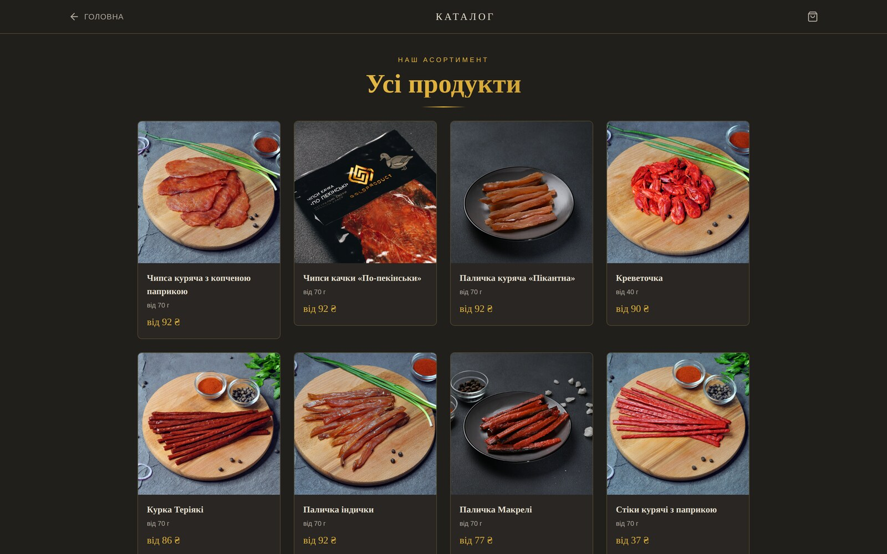
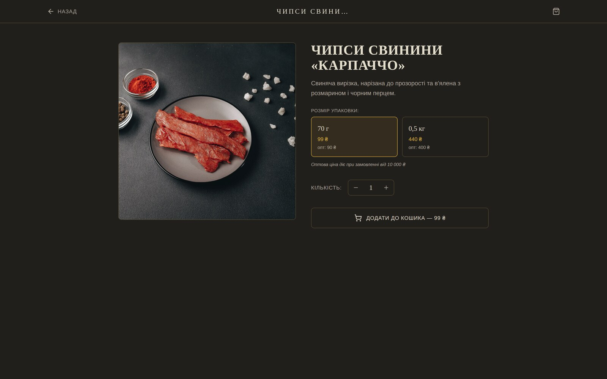
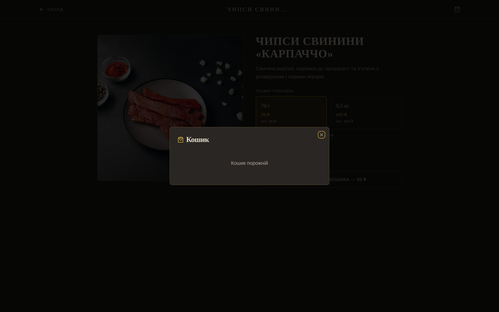
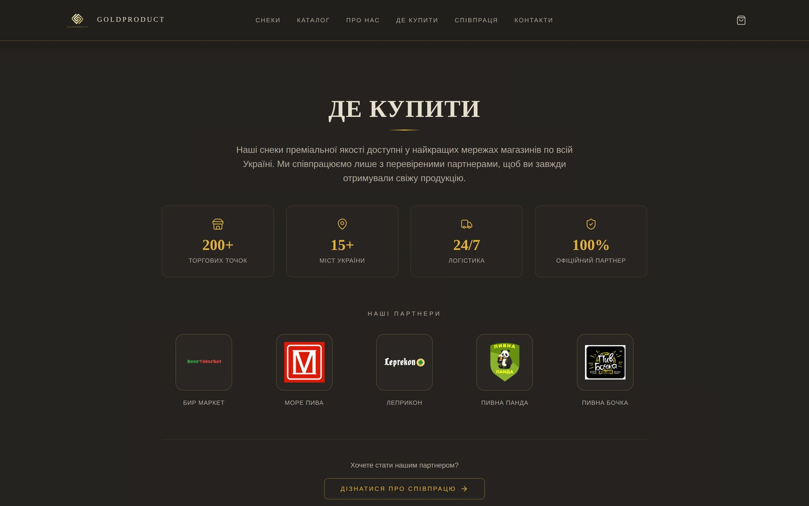
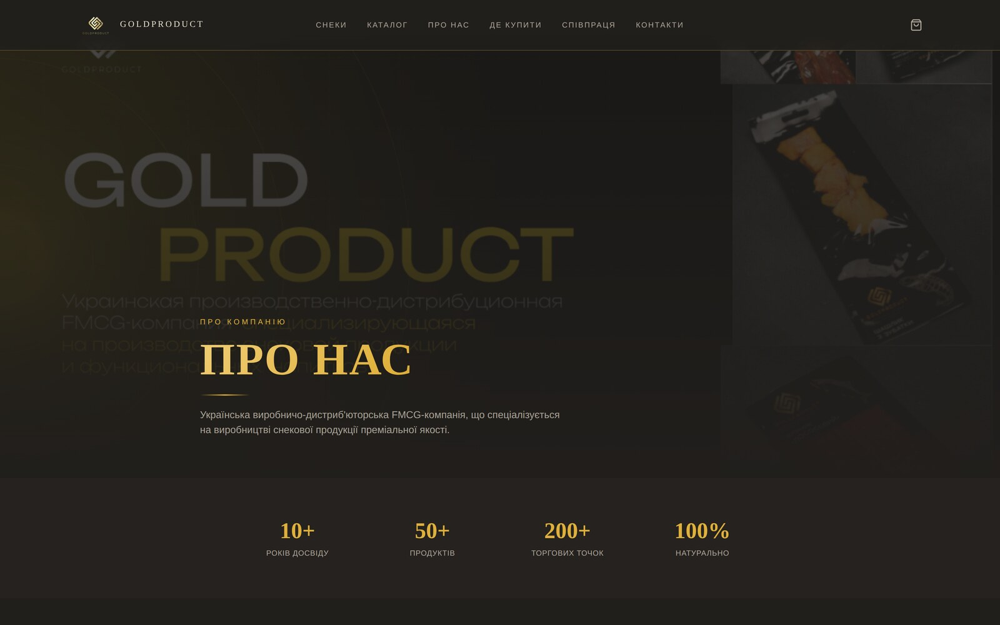
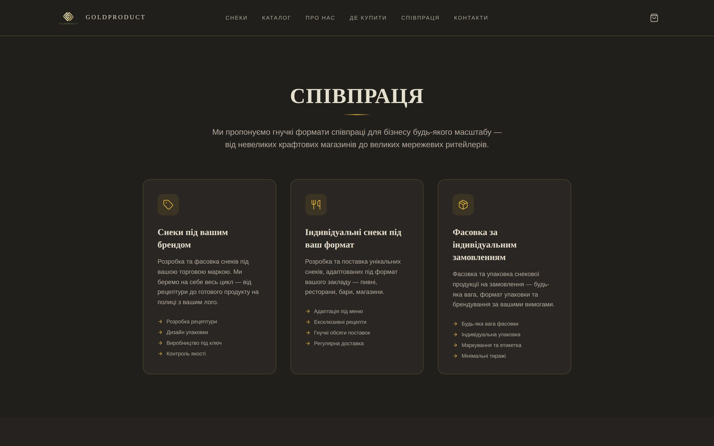
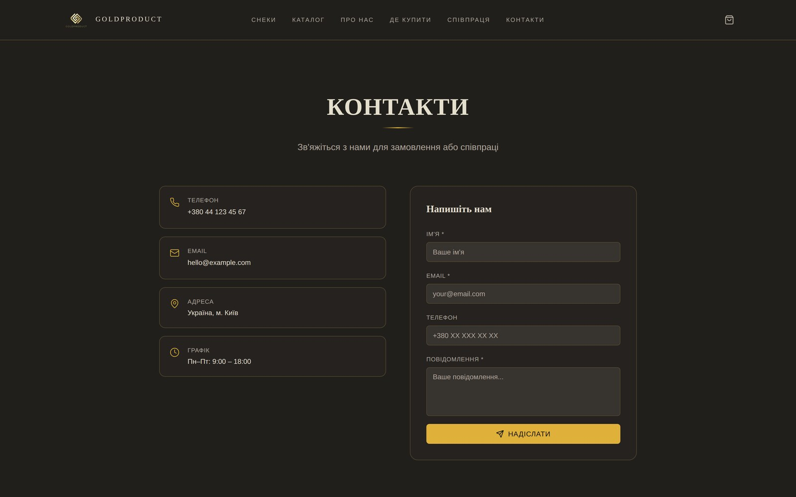
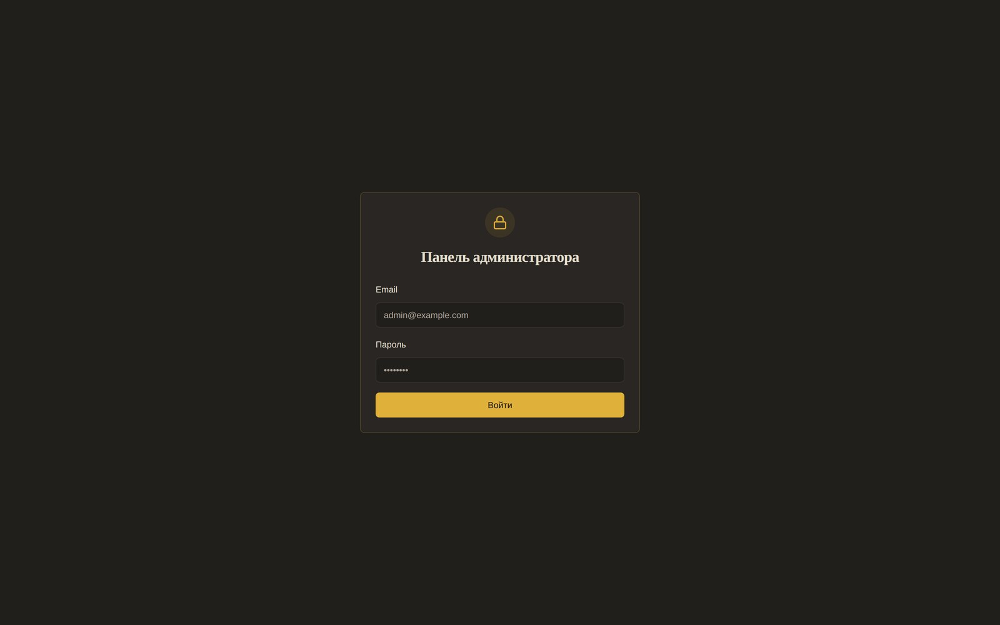

<div align="center">


<h1>GoldProduct</h1>

<p><strong>Ukrainian storefront for premium dried meat and fish snacks.</strong><br>
React 18 · Vite · Tailwind · shadcn/ui · Supabase — catalogue, cart, wholesale pricing,
checkout, Telegram order notifications and an admin panel.</p>

<p>
  <a href="LICENSE"></a>
  
  
  
  
  
  <a href="../../actions/workflows/ci.yml"></a>
</p>

</div>

---

## What this is

A working shop, not a template. Fifteen products across two categories, a cart that switches the
whole basket to wholesale prices once it crosses ₴10 000, a checkout that writes to Postgres and
pings Telegram, and an admin panel with order management and revenue charts.

The parts worth reading are the ones a storefront template usually gets wrong:

- **Orders are created by a `SECURITY DEFINER` function**, not by table inserts. The browser sends
  product ids and quantities; the database looks up the prices. A crafted request cannot book a
  ₴10 000 basket for ₴1.
- **`customers` and `orders` deny reads by default.** Only an authenticated admin can read them, and
  that is [covered by tests](supabase/tests/rls.sql) that run against a real PostgreSQL in CI.
- **Every migration is in the repo, including the catalogue.** `supabase db push` gives you a shop
  with products in it, not an empty grid.

> [!NOTE]
> This repository is a sanitised copy. Phone numbers, email addresses and API keys are placeholders —
> see [`.env.example`](.env.example) and replace them before deploying.

## Screens

<table>
<tr>
<td width="50%"></td>
<td width="50%"></td>
</tr>
<tr>
<td align="center"><em>Catalogue — fifteen products, retail price from the smaller pack</em></td>
<td align="center"><em>Product — pack size switches price, wholesale shown alongside</em></td>
</tr>
<tr>
<td width="50%"></td>
<td width="50%"></td>
</tr>
<tr>
<td align="center"><em>Cart — live wholesale progress, then a seven-field checkout</em></td>
<td align="center"><em>Where to buy — retail chains and partner stores</em></td>
</tr>
</table>

<details>
<summary><strong>More screens</strong> — about, cooperation, contacts, admin</summary>

<br>






</details>

## Features

| | |
|---|---|
| **Two-tier pricing** | Every product has a 70 g and a 0,5 kg pack, each with a retail and a wholesale price. The basket flips to wholesale once the **retail** subtotal reaches ₴10 000 — decided on retail so a basket cannot oscillate around the line. |
| **Cart** | React context keyed on `productId + variant`, so the two pack sizes of one product stay separate lines. Zero quantity removes the line rather than leaving a ghost. |
| **Checkout** | One `place_order` RPC: customer, order and line items in a single transaction, priced server-side, returning the authoritative total. |
| **Telegram notifications** | An edge function reads the order back from the database with the service-role key and formats the message itself — the caller supplies only an order id. |
| **Admin panel** | Order list with status changes, unread notification count, and a revenue/top-products dashboard. Behind Supabase Auth plus a `has_role()` check, lazy-loaded so shoppers never download it. |
| **SEO** | Per-page titles, canonical URLs, Open Graph, Twitter cards and `Organization` / `WebSite` / `Product` JSON-LD, all built from `VITE_SITE_URL`. |
| **Catalogue in migrations** | Products, prices, pack weights and gallery images ship as SQL. Clone, push, run. |

## Stack

| Layer | Choice |
|---|---|
| Build | Vite 5 + `@vitejs/plugin-react-swc` |
| UI | React 18, Tailwind CSS, shadcn/ui (Radix), framer-motion |
| Routing | React Router 6, admin routes code-split |
| Data | TanStack Query |
| Backend | Supabase — Postgres, row-level security, Deno edge functions |
| Tests | Vitest + Testing Library, Playwright, and SQL tests against real PostgreSQL |

## Quick start

```bash
git clone https://github.com/STALK37/GoldProduct.git
cd GoldProduct
npm install
cp .env.example .env
npm run dev            # http://localhost:8080
```

Every page renders immediately. The catalogue, cart and checkout need Supabase —
**[SETUP.md](SETUP.md)** walks through it in about fifteen minutes.

| Script | Does |
|---|---|
| `npm run dev` | Vite dev server |
| `npm run build` | Production build → `dist/` |
| `npm run preview` | Serve the built site |
| `npm test` | Vitest unit tests |
| `npm run test:coverage` | Unit tests with coverage |
| `npm run test:rls` | Row-level-security tests on a throwaway PostgreSQL |
| `npm run test:e2e` | Playwright end-to-end suite |
| `npm run typecheck` | `tsc --noEmit` |
| `npm run lint` | ESLint |

Node 20+.

## Tests

Sixty-nine checks across three layers — 26 unit, 25 row-level-security assertions, 18 end-to-end.

**Unit — `npm test`.** The cart (variant keying, quantity merging, the zero-quantity guard, and the
wholesale threshold from both sides), the checkout dialog, and SEO tag generation. The checkout
tests include a regression guard that asserts **no price of any kind appears in the checkout
payload** — that is the hole `place_order` was written to close, and a test fails if it reopens.

**Row-level security — `npm run test:rls`.** Spins up a temporary PostgreSQL, applies every
migration in order against a small stand-in for the Supabase `auth` schema, then checks the policies
from four angles: anonymous, signed-in shopper, admin, and the checkout function itself. It proves
customers and orders are unreadable, that direct table writes are refused, that a client-supplied
price is ignored, and that out-of-stock and unknown products are rejected. No Supabase project, no
network, no credentials.

**End-to-end — `npm run test:e2e`.** Builds the site, serves it, and walks every route on desktop
and mobile viewports: pages render, the 404 works, **no image is broken**, no console errors, the
canonical tag points at this site, no build-tool placeholder survived into the HTML, and the admin
routes bounce an anonymous visitor back to the login.

```bash
npm test && npm run test:rls && npx playwright install chromium && npm run test:e2e
```

## Project structure

```
src/
├─ pages/                  # one file per route
├─ components/             # Header, HeroSection, ProductCard, CheckoutDialog, SEO…
│  └─ ui/                  # shadcn/ui primitives
├─ contexts/CartContext.tsx
├─ hooks/useAuth.tsx       # Supabase Auth + has_role() admin check
├─ integrations/supabase/  # client + generated types
└─ test/                   # Vitest specs
supabase/
├─ migrations/             # schema history + catalogue seed, apply in order
├─ functions/              # telegram-notify (Deno edge function)
└─ tests/                  # run.sh + rls.sql — policy tests on real PostgreSQL
scripts/create-admin.mjs   # promote an email to administrator
e2e/                       # Playwright specs
```

## Security

Reads on `customers` and `orders` are denied to everyone except authenticated admins, and orders can
only be created through `place_order()`. The reasoning, the threat model and the two vulnerabilities
this repository fixes are written up in **[SECURITY.md](SECURITY.md)** — worth reading before you
change a policy.

## Contributing

See [CONTRIBUTING.md](CONTRIBUTING.md). Please don't open a public issue for security reports —
[SECURITY.md](SECURITY.md) has the contact route.

If this is useful to you, a ⭐ helps other people find it.

## License

[MIT](LICENSE) © Vahe Gevorgyan
